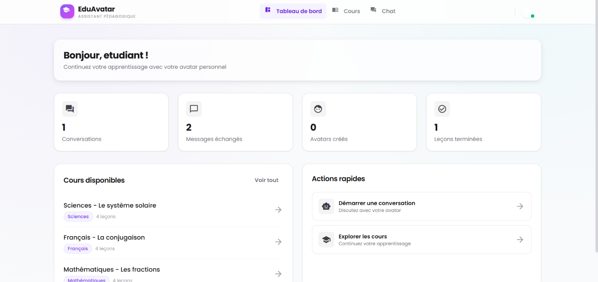
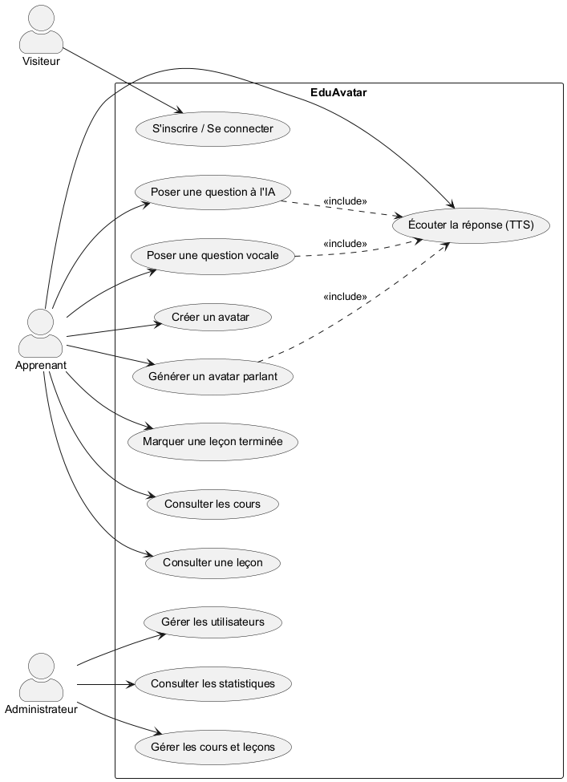
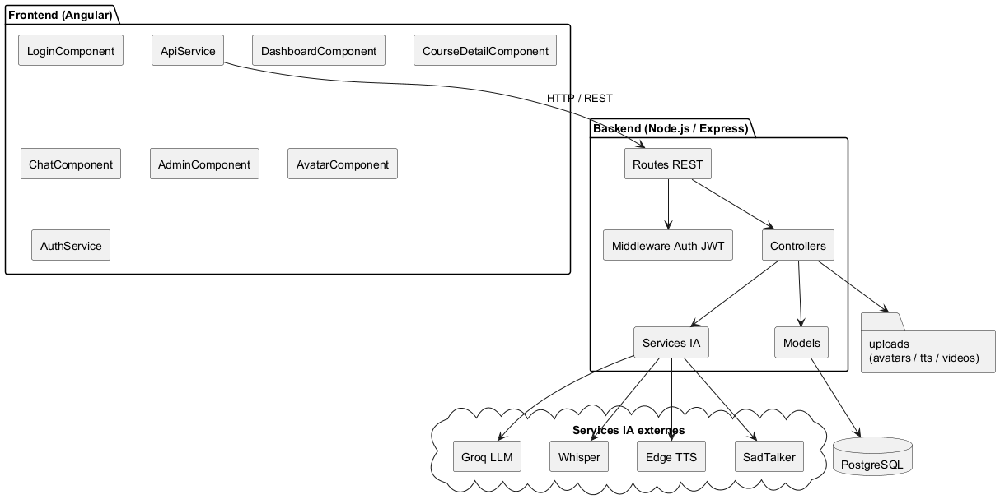
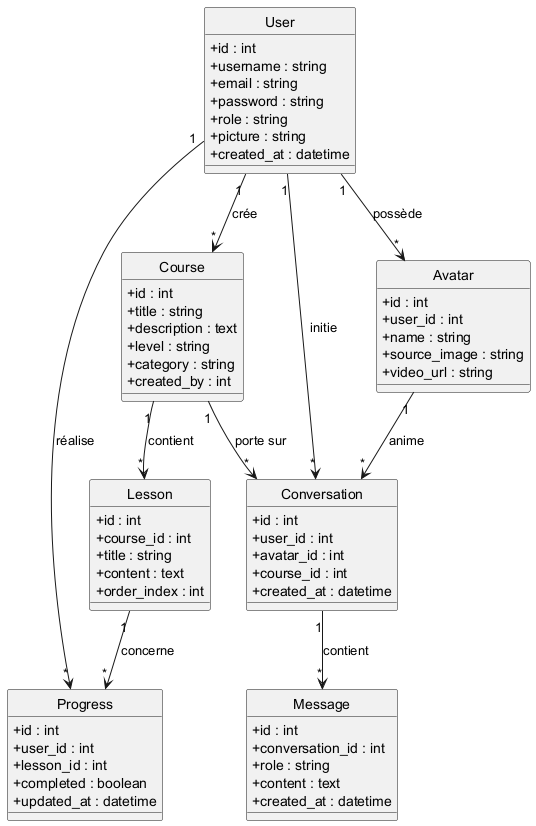
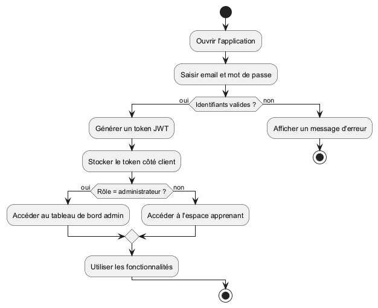
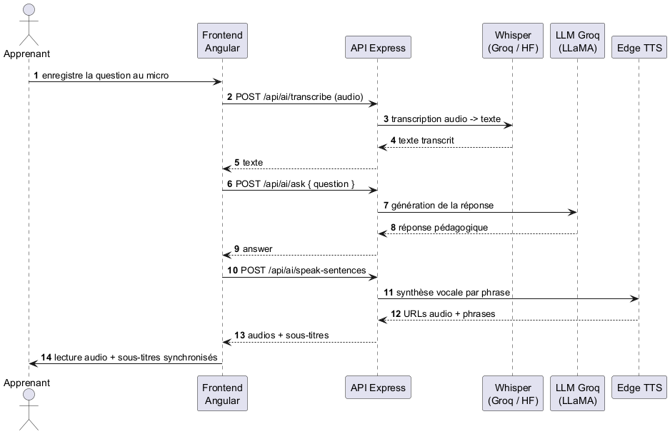
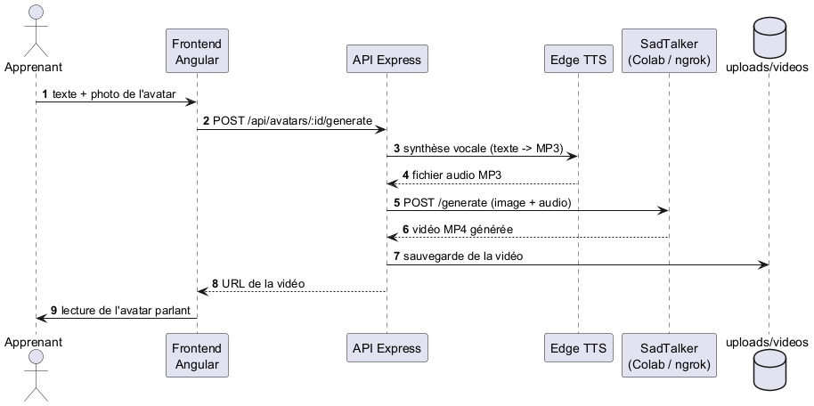
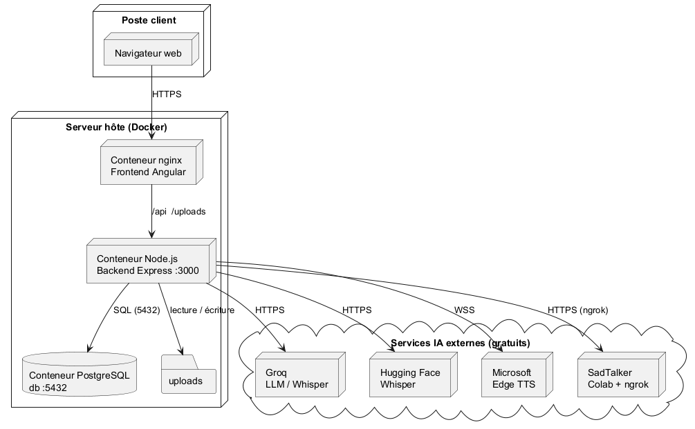

# 🎓 EduAvatar - Système d'assistant pédagogique avec avatar parlant

**EduAvatar** est une application web complète (Projet de Fin d'Année) qui permet aux utilisateurs d'apprendre avec un avatar parlant personnalisé. L'architecture est **hybride** : tout le code tourne en local sur votre machine, mais les modèles IA lourds sont appelés via des **APIs gratuites** externes.

---

## 🏗️ Architecture

```
┌─────────────────────────────────────────────────────────────────┐
│                    VOTRE ORDINATEUR (LOCAL)                     │
│                                                                 │
│  ┌──────────────┐     ┌──────────────────┐     ┌─────────────┐  │
│  │   Angular    │     │  Node.js/Express │     │ PostgreSQL  │  │
│  │   Frontend   │────▶│     Backend      │────▶│  Base de    │  │
│  │  (port 4200) │     │    (port 3000)   │     │  données    │  │
│  └──────────────┘     └────────┬─────────┘     │  (5432)     │  │
│                                │               └─────────────┘  │
└────────────────────────────────┼────────────────────────────────┘
                                 │ Appels API (gratuits)
                                 ▼
                    ┌──────────────────────────┐
                    │      SERVICES IA         │
                    │  (exécutés dans le cloud)│
                    │- Groq (LLM)              │
                    │- HuggingFace (Whisper)   │
                    │- Edge TTS (synthèse)     │
                    │- SadTalker (via Colab)   │
                    └──────────────────────────┘
```

### Services IA utilisés (tous gratuits)

| Service | Rôle | Endpoint | Clé API |
|---------|------|----------|---------|
| **Groq** | LLM des réponses pédagogiques + Whisper (reconnaissance vocale) | `api.groq.com` | Oui (gratuite) |
| **Hugging Face** | Whisper en secours (reconnaissance vocale) | `api-inference.huggingface.co` | Oui (gratuite) |
| **Edge TTS** | Synthèse vocale (français) | `speech.platform.bing.com` | **Non nécessaire** |
| **SadTalker** (Colab) | Génération d'avatar parlant | ngrok URL | ngrok token |

---

## 📁 Structure du projet

```
eduvatar-pfa/
├── frontend/                 # Angular 17 + Tailwind + Material
│   ├── src/app/
│   │   ├── components/       # Login, Register, Dashboard, Chat...
│   │   ├── services/         # Auth, Api, Course, Avatar, Conversation
│   │   ├── models/           # Interfaces TypeScript
│   │   ├── guards/           # AuthGuard, AdminGuard
│   │   └── app.module.ts
│   ├── angular.json
│   ├── Dockerfile
│   └── nginx.conf
│
├── backend/                  # Node.js + Express
│   ├── src/
│   │   ├── models/           # User, Avatar, Course, Lesson, Conversation, Message, Progress
│   │   ├── routes/           # auth, users, courses, lessons, avatars, conversations, stats
│   │   ├── controllers/      # Logique métier
│   │   ├── services/         # groq, whisper, tts, sadtalker
│   │   ├── middleware/       # auth, upload
│   │   └── app.js
│   ├── package.json
│   └── Dockerfile
│
├── colab-scripts/            # Scripts SadTalker + ngrok
├── captures/                 # Captures d'écran de l'application
│   └── uml/                  # Diagrammes UML (sources .puml + PNG)
├── Rapport_PFA_EduAvatar.docx # Rapport académique du projet
├── docker-compose.yml
└── .env.example
```

---

## 📸 Aperçu de l'application (captures d'écran)

### Interfaces apprenant

<table>
  <tr>
    <td align="center" width="50%">
      <br>
      <b>Figure 1 — Page de connexion</b>
    </td>
    <td align="center" width="50%">
      <br>
      <b>Figure 2 — Tableau de bord de l'apprenant</b>
    </td>
  </tr>
  <tr>
    <td align="center" width="50%">
      <br>
      <b>Figure 3 — Liste des cours</b>
    </td>
    <td align="center" width="50%">
      <br>
      <b>Figure 4 — Détail d'un cours et de ses leçons</b>
    </td>
  </tr>
  <tr>
    <td align="center" width="50%">
      <br>
      <b>Figure 5 — Explication d'une leçon par l'IA</b>
    </td>
    <td align="center" width="50%">
      <br>
      <b>Figure 6 — Chat avec l'avatar pédagogique</b>
    </td>
  </tr>
</table>

### Interfaces administrateur

<table>
  <tr>
    <td align="center" width="50%">
      <br>
      <b>Figure 7 — Tableau de bord administrateur</b>
    </td>
    <td align="center" width="50%">
      <br>
      <b>Figure 8 — Ajout d'un nouveau cours</b>
    </td>
  </tr>
  <tr>
    <td align="center" width="50%">
      <br>
      <b>Figure 9 — Gestion des utilisateurs</b>
    </td>
    <td align="center" width="50%">
      <br>
      <b>Figure 10 — Page des statistiques</b>
    </td>
  </tr>
  <tr>
    <td align="center" width="50%">
      <br>
      <b>Figure 11 — Création et génération d'un avatar parlant</b>
    </td>
    <td align="center" width="50%">
      <i>Les figures sont également intégrées au rapport académique
      (<code>Rapport_PFA_EduAvatar.docx</code>, section 4.11).</i>
    </td>
  </tr>
</table>

---

## 🧩 Diagrammes UML

Les diagrammes ont été générés avec **PlantUML** (sources éditables dans `captures/uml/*.puml`).

<table>
  <tr>
    <td align="center" width="50%">
      <br>
      <b>Cas d'utilisation</b>
    </td>
    <td align="center" width="50%">
      <br>
      <b>Architecture en composants</b>
    </td>
  </tr>
  <tr>
    <td align="center" width="50%">
      <br>
      <b>Diagramme de classes</b>
    </td>
    <td align="center" width="50%">
      <br>
      <b>Diagramme d'activité (authentification)</b>
    </td>
  </tr>
  <tr>
    <td align="center" width="50%">
      <br>
      <b>Séquence — question vocale et réponse parlée</b>
    </td>
    <td align="center" width="50%">
      <br>
      <b>Séquence — génération d'un avatar parlant</b>
    </td>
  </tr>
  <tr>
    <td align="center" width="50%">
      <br>
      <b>Diagramme de déploiement</b>
    </td>
    <td align="center" width="50%"></td>
  </tr>
</table>

Pour régénérer les diagrammes :
```bash
java -jar plantuml.jar -tpng -charset UTF-8 "captures/uml/*.puml"
```

---

## 🚀 Démarrage rapide (Docker)

### Prérequis
- Docker Desktop (avec Docker Compose)
- Git (optionnel)

### Étape 1 : Créer le fichier `.env`

À la racine du projet :
```bash
cp .env.example .env
```

Renseignez au minimum les clés API suivantes (toutes gratuites) :
- `GROQ_API_KEY` : créer un compte sur [console.groq.com](https://console.groq.com)
- `HF_API_KEY` : créer un token sur [huggingface.co/settings/tokens](https://huggingface.co/settings/tokens)

### Étape 2 : Lancer l'application

```bash
# Depuis le dossier eduvatar-pfa
docker-compose up --build -d
```

### Étape 3 : Vérifier le démarrage

```bash
# Vérifier que tous les services tournent
docker-compose ps
```

Les services seront disponibles :
| Service | URL |
|---------|-----|
| **Frontend (Angular)** | http://localhost:4200 |
| **Backend (API)** | http://localhost:3000 |
| **PostgreSQL** | localhost:5432 (user: eduvatar / pass: eduvatar123) |

### Étape 4 : Créer les données de démonstration

```bash
docker-compose exec backend npm run seed
```

Cela crée :
- **Admin** : `admin@eduvatar.com` / `admin123`
- **User** : `user@eduvatar.com` / `user123`
- 3 cours avec 4 leçons chacun

### Arrêter l'application

```bash
docker-compose down          # Arrête les services
docker-compose down -v       # Arrête ET supprime les données
```

---

## 🧪 Tests des fonctionnalités

### 1. Authentification
- Ouvrez http://localhost:4200
- Connectez-vous avec le compte test ou créez un compte
- Vérifiez que vous êtes redirigé vers le tableau de bord

### 2. Gestion utilisateurs (Admin)
- Connectez-vous avec le compte admin
- Allez sur `/admin` → onglet "Utilisateurs"
- Vous pouvez supprimer des comptes

### 3. CRUD des cours
- Connectez-vous avec le compte admin
- Allez sur `/admin` → onglet "Cours"
- Créez un cours, vérifiez qu'il apparaît dans la liste

### 4. Consultation des cours (User)
- Connectez-vous en tant qu'utilisateur
- Allez sur `/courses` → sélectionnez un cours
- Ouvrez les leçons et marquez-les comme terminées
- La barre de progression se met à jour

### 5. Création d'avatar
- Connectez-vous
- Allez sur `/avatar-creator`
- Téléversez une photo, donnez un nom à l'avatar
- Vérifiez qu'il apparaît dans la liste

### 6. Chat avec l'avatar
- Connectez-vous
- Créez une conversation sur `/chat`
- Envoyez un message → le backend appelle Groq pour répondre
- (Un bouton "Écouter" déclenche la synthèse vocale Edge TTS, sans clé API)

### 7. Dashboard statistiques
- `/dashboard` : statistiques personnelles
- `/admin` → "Statistiques" : statistiques globales

---

## 📡 Configuration des services IA

### Groq (réponses intelligentes)

1. Créez un compte gratuit : https://console.groq.com
2. Générez une clé API
3. Ajoutez-la dans le `.env` : `GROQ_API_KEY=votre-cle`
4. Le backend utilise le modèle défini par `GROQ_MODEL` (par défaut `llama-3.3-70b-versatile`)

**Test** : `curl -X POST http://localhost:3000/api/health`

### Hugging Face (Whisper - reconnaissance vocale)

1. Créez un compte : https://huggingface.co
2. Créez un token : Settings → Access Tokens
3. Ajoutez-le dans le `.env` : `HF_API_KEY=hf_...`

### Edge TTS (synthèse vocale - GRATUIT sans clé)

Aucune configuration nécessaire. Le service utilise `fr-FR-DeniseNeural` par défaut.

### SadTalker (avatar parlant)

1. Ouvrez : https://colab.research.google.com
2. Créez un notebook avec **GPU** (Runtime → Change runtime type → GPU)
3. Copiez le contenu de `colab-scripts/sadtalker-colab-setup.sh`
4. Ajoutez votre token ngrok (https://dashboard.ngrok.com)
5. Exécutez toutes les cellules
6. Copiez l'URL ngrok générée dans le `.env` : `SADTALKER_API_URL=https://xxxx.ngrok-free.app`

---

## 🖥️ Développement en local (sans Docker)

Si vous préférez développer sans Docker :

### Base de données
```bash
# Installez PostgreSQL localement puis :
createdb eduvatar
```

### Backend
```bash
cd backend
cp .env.example .env   # Configurez les clés IA
npm install
npm run dev            # Le serveur démarre avec nodemon (rechargement auto)
```

### Frontend
```bash
cd frontend
npm install
npm start              # Angular démarre sur http://localhost:4200
```

### Initialiser la base
```bash
cd backend
node src/initDb.js     # Crée les tables
npm run seed           # Crée les données de démo
```

---

## 🗄️ API Backend - Référence complète

| Méthode | Endpoint | Description | Accès |
|---------|----------|-------------|-------|
| POST | `/api/auth/register` | Inscription | Public |
| POST | `/api/auth/login` | Connexion | Public |
| GET | `/api/auth/me` | Profil actuel | Connecté |
| GET | `/api/users` | Liste des utilisateurs | Admin |
| GET | `/api/users/:id` | Détail utilisateur | Admin |
| PUT | `/api/users/:id` | Modifier utilisateur | Connecté |
| DELETE | `/api/users/:id` | Supprimer utilisateur | Admin |
| GET | `/api/courses` | Liste des cours | Connecté |
| GET | `/api/courses/:id` | Détail cours + leçons | Connecté |
| POST | `/api/courses` | Créer un cours | Admin |
| PUT | `/api/courses/:id` | Modifier un cours | Admin |
| DELETE | `/api/courses/:id` | Supprimer un cours | Admin |
| POST | `/api/courses/:id/lessons` | Créer une leçon | Admin |
| PUT | `/api/lessons/:id` | Modifier une leçon | Admin |
| DELETE | `/api/lessons/:id` | Supprimer une leçon | Admin |
| POST | `/api/lessons/:id/complete` | Marquer leçon terminée | Connecté |
| POST | `/api/avatars` | Créer un avatar (upload) | Connecté |
| GET | `/api/avatars` | Mes avatars | Connecté |
| POST | `/api/avatars/:id/generate` | Générer la vidéo | Connecté |
| POST | `/api/conversations` | Créer une conversation | Connecté |
| GET | `/api/conversations` | Mes conversations | Connecté |
| GET | `/api/conversations/:id` | Détail + messages | Connecté |
| POST | `/api/conversations/:id/messages` | Envoyer un message (LLM) | Connecté |
| DELETE | `/api/conversations/:id` | Supprimer une conversation | Connecté |
| POST | `/api/ai/explain` | Explication IA d'une leçon | Connecté |
| POST | `/api/ai/ask` | Poser une question à l'IA | Connecté |
| POST | `/api/ai/speak` | Synthèse vocale (TTS) | Connecté |
| POST | `/api/ai/speak-sentences` | TTS phrase par phrase (sous-titres) | Connecté |
| POST | `/api/ai/transcribe` | Reconnaissance vocale (Whisper) | Connecté |
| GET | `/api/stats` | Statistiques globales | Admin |
| GET | `/api/stats/user` | Stats personnelles | Connecté |
| GET | `/api/stats/by-course` | Statistiques par cours | Admin |

---

## 🛠️ Dépannage

### L'application web ne charge pas
```bash
docker-compose logs frontend    # Voir les logs
docker-compose restart frontend
```

### Erreur de connexion à la base
```bash
docker-compose logs db
# Vérifiez que le conteneur db est "healthy"
```

### Les réponses du chat ne fonctionnent pas
- Vérifiez que `GROQ_API_KEY` est renseignée dans le `.env`
- Redémarrez le backend : `docker-compose restart backend`
- Sans clé, le backend répond en "mode dégradé" (réponses génériques)

### L'avatar vidéo ne se génère pas
- SadTalker nécessite le notebook Colab lancé
- Vérifiez que `SADTALKER_API_URL` est correcte dans le `.env`
- Testez l'URL avec : `curl VOTRE_URL_NGROK/health`

---

## 📅 Phases du projet (Planning PFA)

| Phase | Contenu | Statut |
|-------|---------|--------|
| **Phase 1** | Configuration (Angular + Node + Docker) | ✅ Complète |
| **Phase 2** | Backend (Auth JWT, modèles, routes, services IA) | ✅ Complète |
| **Phase 3** | Frontend (pages, services, chat, dashboard) | ✅ Complète |
| **Phase 4** | Intégration IA (Groq, Whisper, Edge TTS, SadTalker) | 🔄 Configurable |
| **Phase 5** | Big Data simplifié (statistiques, dashboard admin) | ✅ Incluse |
| **Phase 6** | Communication alternative (pictogrammes ARASAAC) | À venir |

---

## 📄 Licence

Projet académique (PFA) - Usage pédagogique uniquement.
"EduAvatar" - Assistant pédagogique avec avatar parlant.
